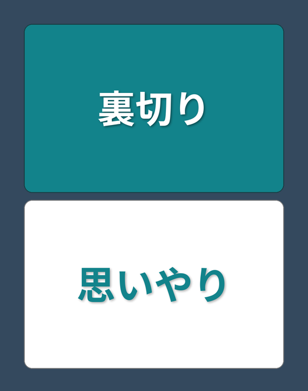

# 痛みと願いカード ウィジェット（Android）

ホーム画面の 2×2 ウィジェットに、**上段＝痛みカード / 下段＝願いカード** を1枚ずつ表示します。



- 毎日決まった時刻に次のカードへ切り替わります（初期値 **20:00**。アプリの「毎日の切り替え時刻」で変更できます）
  - 時刻を変えても今のカードはそのまま。新しい時刻が次に来たときに切り替わります
- 痛み・願いそれぞれ 54 枚をランダムな順番で並べ、**54 日間は重複なし**。全部出たら新しい順番で次の 1 周へ
  （周の変わり目で同じカードが 2 日続かないようにしています）
- アプリを開くと今日のカード・次の切り替え時刻・何周目の何日目かを確認できます
- 「表示した回数をリセット」で、確認のうえ1周目の1日目から新しい順番でやり直せます
- 「カード一覧を見る」で痛みカード・願いカード各54枚を一覧表示（今日のカードには印がつきます）
- ウィジェットをタップするとアプリが開きます

## APK の入手とインストール

1. GitHub の **Actions → 「Android widget APK」** を開き、最新の実行結果の **Artifacts** から
   `itami-negai-widget-apk` をダウンロード（zip を展開すると `itami-negai-widget.apk`）
2. APK をスマホに送り、タップしてインストール（「提供元不明のアプリ」の許可を求められたら許可）
3. ホーム画面の空いているところを長押し →「ウィジェット」→「痛みと願いカード」を 2×2 で配置
   （アプリ内の「ホーム画面にウィジェットを追加」ボタンからも追加できます）

> 機種の省電力設定によっては切り替えが数分遅れることがあります。その場合は設定でこのアプリの
> 「バッテリーの最適化」を「制限なし」にしてください。

## 構成

```
app/src/main/java/.../CardDeck.kt          山札（シャッフル・1日1枚・周回）と切り替え時刻の管理
app/src/main/java/.../CardListActivity.kt   カード一覧画面
app/src/main/java/.../CardWidgetProvider.kt ウィジェットの表示
app/src/main/java/.../RolloverScheduler.kt  毎日の切り替え時刻のアラーム
app/src/main/res/drawable-nodpi/            カード画像 pain_01〜54 / wish_01〜54（番号は元のカード一覧の番号）
app/src/main/res/values/cards.xml           カード画像とカードの言葉の対応表
tools/render.py, tools/cards.py             カード画像の生成スクリプト
signing/sideload.keystore                   個人インストール用の署名鍵（上書きインストールで進捗を保つため固定）
```

## カード画像について

元のカード一覧画像から、カードの比率（横長 約1.53:1）、角丸、枠線、文字の大きさ・行間・位置をカードごとに実測し、
**Noto Sans JP Bold** で描き直しています（高解像度 960×624px）。色は `#12838b`、文字には元カード同様の淡い影をつけています。

再生成する場合は、元のカード一覧画像（願い＝1.jpg、痛み＝2.jpg）と Noto Sans JP Bold を用意し、
`tools/render.py` のパスを合わせて `python3 render.py <出力先>` を実行してください。

## ローカルでビルドする場合

Android Studio でこの `android-widget` フォルダを開き、Run するか `./gradlew assembleRelease` を実行します。
